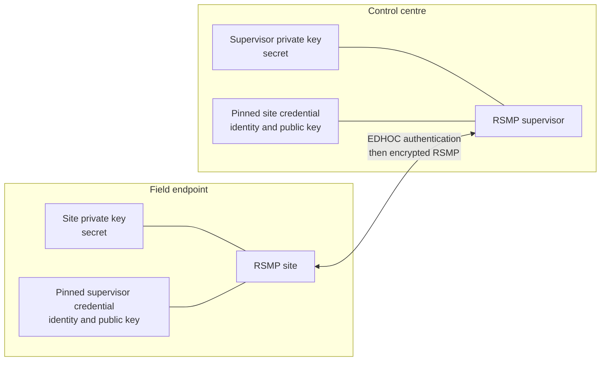
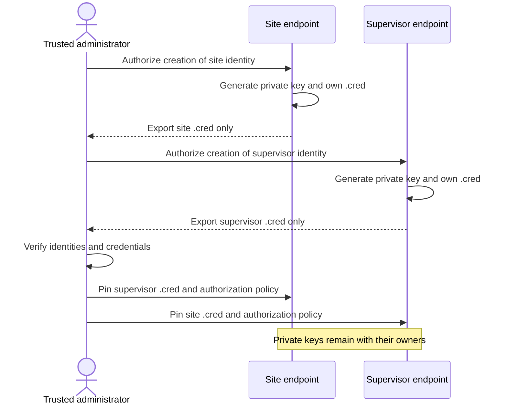
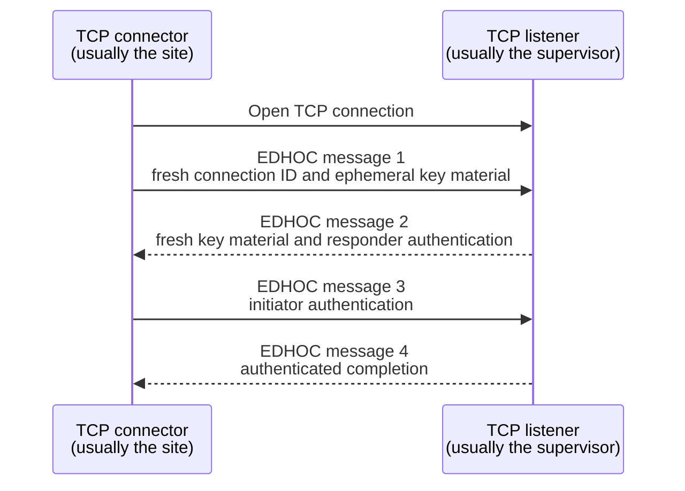
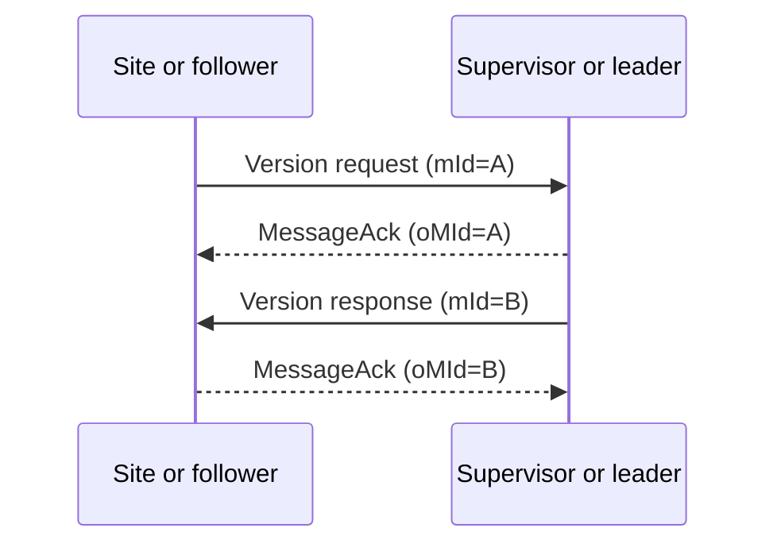
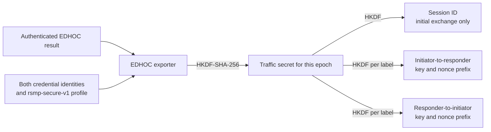
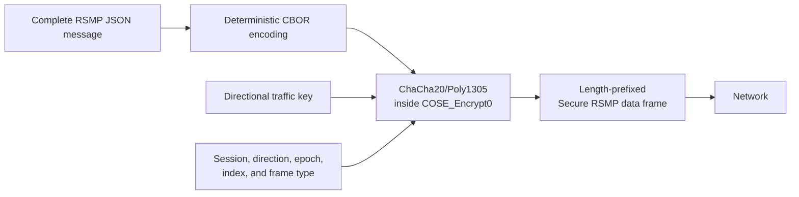
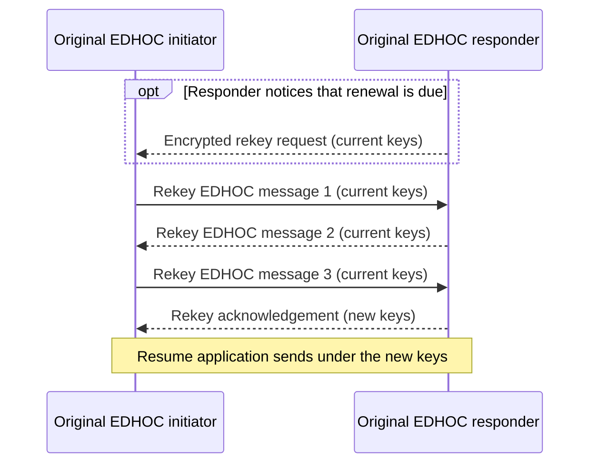
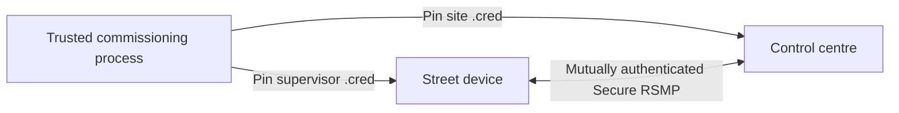

# Secure RSMP v1 explained - draft

This is a plain-language companion to the
[Secure RSMP v1 proposal](./RSMP%20Secure%20v1%20-%20CBOR%20COSE%20proposal.md).
It explains the ideas behind the protocol, but it is not a replacement for the
proposal's exact requirements.

Secure RSMP protects the messages exchanged between an RSMP site and an RSMP
supervisor. Before either endpoint accepts an ordinary RSMP message, they:

1. prove their identities to each other;
2. create fresh session keys that are known only to them; and
3. verify which RSMP identity, role, and Core version the authenticated peer is
   allowed to use.

After that, every RSMP message is encrypted and integrity-protected. Captured
messages cannot simply be read, modified, injected, reordered, or replayed.

## The short version

Each endpoint has two long-term files:

- A **private key** is its secret proof of identity. It stays on the endpoint
  that owns it.
- A **credential** contains the endpoint's name, public key, and key identifier.
  Copies are installed on peers that are allowed to trust that endpoint.

When a connection starts, EDHOC performs a mutually authenticated handshake.
The endpoints use their long-term identity keys to authenticate the handshake
and fresh, temporary X25519 keys to produce shared secret material. They then
derive separate encryption keys for each direction of the connection.

The long-term private keys do **not** encrypt the RSMP traffic. Their job is to
authenticate the creation of short-lived session keys. This limits the amount
of data protected by any one key and gives past sessions forward secrecy.

In the usual setup the site opens the TCP connection and is the EDHOC
initiator, while the supervisor listens and is the EDHOC responder. RSMP also
supports the reverse connection direction. The security roles always follow
the TCP connection direction, not the words "site" and "supervisor".

## Standard building blocks, combined for RSMP

Secure RSMP does not invent new cryptographic algorithms. It combines existing,
published standards into one fixed profile and adds the RSMP-specific rules
needed to make them work together.

| Building block | Existing standard or established algorithm | Job in Secure RSMP |
| --- | --- | --- |
| EDHOC | RFC 9528 | Mutually authenticates the endpoints and establishes fresh shared secret material |
| CBOR | RFC 8949 | Gives messages a compact and unambiguous binary representation |
| COSE `Encrypt0` | RFC 9052 and RFC 9053 | Defines the protected container around each RSMP message |
| CDDL | RFC 8610 | Describes the permitted CBOR message structures for validation and testing |
| Ed25519/EdDSA | RFC 8032 | Provides long-term identity signatures |
| X25519 | RFC 7748 | Creates fresh ephemeral secret material for forward secrecy |
| HKDF-SHA-256 | RFC 5869 | Derives separate session, direction, key, and nonce values |
| ChaCha20/Poly1305 | RFC 8439 | Encrypts messages and detects modification |

Using established components matters because their algorithms, formats, and
security properties have already received broad public analysis. Implementers
can reuse reviewed cryptographic libraries, published test vectors, standard
terminology, and existing diagnostic tools instead of designing and validating
new cryptography from scratch. Independent implementations in different
languages can interoperate because they have precise common definitions.

The fixed profile also removes many choices that could otherwise differ between
vendors. Every conforming v1 endpoint uses the same handshake method, cipher
suite, credential shape, encodings, and traffic-protection algorithm. This
makes conformance testing more focused and prevents negotiation from silently
selecting a weaker or incompatible mode.

Standards are building blocks, not a security guarantee. Secure RSMP still
defines its own framing, credential-pinning rules, RSMP authorization, exporter
context, key schedule, replay checks, and rekey state machine. Those rules must
be reviewed and implemented exactly. The cryptographic library, random-number
generator, private-key storage, provisioning process, and endpoint itself must
also be secure.

Consequently, an implementation that supports EDHOC or COSE in general is not
automatically compatible with Secure RSMP. It must support the exact
`rsmp-secure-v1` profile and pass its additional conformance requirements.

## Three different kinds of key material

It helps to keep the following items separate:

| Item | Lifetime | Where it exists | Purpose |
| --- | --- | --- | --- |
| Ed25519 private key | Long term | Only at its owning endpoint | Proves the endpoint's identity by signing during EDHOC |
| `.cred` credential | Long term | At its owner and every peer that trusts it | Binds an identity to an Ed25519 public key |
| Traffic keys and nonce prefixes | One session-key epoch | In memory at both endpoints | Encrypt and authenticate RSMP messages |

The credential also contains a 16-byte key identifier, or **KID**, derived from
the public key. The KID is a compact way to say which already-provisioned
credential should be used. It is not a secret.

The `.cred` file is not a certificate whose trust can be inferred from a
certificate authority or from a self-signature. Secure RSMP uses **credential
pinning**: an endpoint trusts the exact credential that an administrator has
placed in its local trust store.

## How keys and credentials are provisioned

Provisioning happens before the endpoints connect. It is part of commissioning
and operations, not part of the Secure RSMP network protocol.

A good provisioning flow is:

1. Create a unique Ed25519 identity for every endpoint. Generate it on the
   endpoint or in protected key hardware when possible.
2. Keep the private key on its owner. If it must be installed from another
   system, use a protected administrative process and tightly restrict access.
3. Export the non-secret `.cred` file, which contains the identity and public
   key, but never the private key.
4. Verify the credential and install it on each peer that should trust this
   endpoint.
5. Configure policy that maps the credential identity to one expected RSMP
   identity and role, and optionally to permitted Core versions.

The administrative path must itself be authenticated. For example, credentials
can be transferred through a controlled device-management system or verified
during physical commissioning. Encryption on the RSMP connection cannot repair
a trust store that was populated with an attacker's credential.

Provisioning is needed in both directions because authentication is mutual:
the supervisor verifies the site, and the site verifies the supervisor.

### Replacement and revocation

Replacing a long-term key means creating a new pair, distributing and verifying
the new credential, coordinating activation, and establishing a new connection.
Overwriting one side without first updating its peers causes authentication to
fail, which is the safe outcome.

Removing or revoking a pinned credential prevents it from being accepted on new
connections. An existing connection using a revoked credential should also be
closed. Provisioning, replacement, revocation, backup, and recovery therefore
need an explicit operational procedure and audit trail.

## How mutual authentication works

Secure RSMP uses EDHOC, a compact authenticated key-establishment protocol. It
combines two jobs in one handshake:

- **Authentication:** each endpoint proves that it holds the private key for a
  credential the other endpoint has already pinned.
- **Key establishment:** fresh temporary X25519 keys create shared secret
  material for this connection.

Each endpoint sends a KID reference. The receiver looks up that KID only in its
local trust store. An unknown KID is rejected; a peer cannot make itself trusted
by supplying new credential material during the handshake.

All four initial EDHOC messages are required. Once the listener has verified
message 3 and successfully sent message 4, it can start the encrypted RSMP
exchange in its application role. The connector can do so once it has verified
message 4. A handshake failure or a two-second timeout closes the connection.
For example, a listener that receives a well-formed message 1 selecting an
unsupported suite reports suite 4 in an EDHOC error and closes. The connector
also closes on receipt of the error.

### Authentication is not authorization

Authentication answers:

> Does this peer possess the private key matching a credential I trust?

Authorization answers:

> May this credential act as this particular RSMP identity and role, using this
> Core version?

The site sends the first encrypted `Version` request, even when the supervisor
opened the TCP connection. For a connection between sites, the follower sends
the request and the leader answers. Each side checks the peer's `Version`
against the selected Core version and its local authorization policy before
acknowledging it.

All four messages are encrypted. A and B stand for the distinct IDs of the
request and response. In Core 3.3.0, the `step` field identifies each as
`Request` or `Response`. Earlier versions without `step` use the sender's
role and the order of the exchange.

When a site connects to one of several trusted supervisors, its connection
configuration selects that supervisor's pin before the handshake. A listener
can serve several peers and finds the permitted identity and role from the
credential each peer authenticates with.

The request names the site, or the follower on a site-to-site connection.
Its `siteId` list must contain exactly that one authorized site, even with
Core 3.2.2, which allows multiple sites on a plain RSMP connection. In a
legacy response the same field refers back to the requesting site. In Core
3.3.0 the response carries a required, informational `supervisorId`. In both
cases the supervisor's or leader's authorized identity comes from the local
policy for its pinned credential.

Each endpoint continues Core startup once it has accepted and acknowledged
the peer's `Version` and received the acknowledgement for its own. A
`MessageNotAck` for either message ends the connection. The authorized
identity, role, and Core version stay fixed until the connection closes.

This separation stops a valid credential for one device from being reused to
claim the identity or permissions of another device.

## How session keys are created

The temporary X25519 keys from EDHOC produce shared secret material without
sending that secret across the network. The Ed25519 signatures bind the
temporary exchange to both provisioned identities, preventing an
unauthenticated man in the middle from substituting its own keys.

After EDHOC succeeds, both endpoints independently perform the same derivation:

Including both authenticated identities and the exact profile name in the
derivation binds the keys to this Secure RSMP context. Separate keys and nonce
prefixes for each direction prevent traffic in one direction from sharing the
same cryptographic state as traffic in the other. At rekey, a fresh EDHOC
exporter result supplies the next epoch's traffic secret. The endpoints replace
the directional keys and nonce prefixes and keep the original session ID.

Because the session keys depend on fresh ephemeral X25519 material, recording a
connection and stealing a long-term Ed25519 key later is not enough to decrypt
that completed connection. This property is called **forward secrecy**. It does
not protect an active epoch if the endpoint or its in-memory traffic secrets are
compromised while the connection is running.

## How RSMP messages are encrypted

Each complete RSMP JSON message goes through the following pipeline:

CBOR is a compact, unambiguous representation of the message; it is not itself
encryption. COSE provides the standard protected container. ChaCha20/Poly1305
is an authenticated-encryption algorithm, which produces both ciphertext and
an authentication tag.

On receipt, the peer first checks the expected frame index and authentication
tag. Only if those checks succeed does it decrypt and pass the recovered RSMP
message to normal RSMP validation and dispatch.

The authentication tag covers not only the encrypted message but also security
context including:

- the session identifier;
- traffic direction;
- key epoch;
- frame index; and
- whether the frame contains application data or rekey control data.

Changing any protected part causes verification to fail and the connection to
close.

### Replay and ordering protection

Each direction has its own frame index, starting at 1 for every key epoch. The
receiver accepts only the exact next value. A duplicated, skipped, reordered,
invalid, or exhausted index is fatal.

This strict sequence check prevents an attacker from capturing a legitimate
command and successfully sending it again. It also ensures that a nonce is
never reused with the same traffic key, which is essential for the safety of
ChaCha20/Poly1305.

## How traffic keys are renewed

Traffic keys are periodically replaced in a **rekey** operation. The initial
keys are epoch 0; each successful rekey increments the epoch by one.

Only the endpoint that initiated the original EDHOC handshake starts the rekey
EDHOC exchange. The other endpoint can request it. Rekey control messages are
themselves encrypted with the current keys, and fresh ephemeral material is
used to derive the next keys.

The two directions can carry traffic at the same time. For example, a site may
receive a status request just after it starts renewal. It processes the request
if it arrives before the peer's first rekey control. TCP puts that control
after any data the peer already sent. For the initiator the control is message 1.
For the responder it is the rekey request, or message 2 if it sent no request.
Any later application data under the old keys closes the connection.

The responder's rekey acknowledgement is the first frame protected by the new
keys. Verifying it confirms that both peers derived the same keys. Its outer
epoch and its encrypted `next_epoch` both name the new epoch. It uses
responder index 1, so the responder's next frame uses index 2. The initiator's
first frame in that epoch uses index 1.

The responder can send queued RSMP messages after sending the acknowledgement,
and the initiator can send them after verifying it. This includes any RSMP
acknowledgements owed for messages received during the pause. If rekey
fails or takes more than two seconds, the connection closes rather than
continuing with unsafe or ambiguous key state.

Rekey must finish before any per-direction, per-epoch maximum is exceeded:

| Limit | Maximum |
| --- | ---: |
| Protected frames | 1,000,000 |
| Ciphertext | 64 GiB |
| Epoch lifetime | 2 hours |

A deployment may choose lower limits. At the four-frame minimum, the responder
can send the opening acknowledgement, one application message, and the two
controls it sends under that epoch's keys when it requests renewal.
The byte budget must also fit those four frames, including their tags. The
lifetime must leave time for application traffic before the two-second renewal
window.

## Why this design is secure

| Attack or mistake | Protection |
| --- | --- |
| Someone listens to the network | RSMP content is encrypted with session traffic keys |
| Someone modifies a frame | The authentication tag fails and the connection closes |
| Someone injects a fabricated frame | They cannot create a valid tag without the traffic key |
| Someone impersonates an endpoint | They need the private key matching a locally pinned credential |
| A valid endpoint claims another RSMP identity | Separate authorization checks identity, role, and Core version |
| Someone replays or reorders captured traffic | Strict per-direction frame indexes reject it |
| An attacker forces a weaker algorithm or plaintext | The profile fixes its algorithms and has no plaintext fallback |
| A long-term key is stolen in the future | Fresh ephemeral key agreement protects previously completed, uncompromised sessions |
| A traffic key is used for too long | Mandatory rekey limits replace it |

Security does not come from encryption alone. It comes from the combination of
authenticated provisioning, mutual authentication, fresh key agreement,
authorization, authenticated encryption, replay protection, renewal, and
fail-closed behavior.

## How this differs from TLS

TLS and Secure RSMP solve many of the same basic problems. Both can authenticate
endpoints, create fresh session keys, encrypt traffic, detect modification, and
provide forward secrecy. Secure RSMP is not automatically "more secure" than a
well-configured TLS 1.3 connection. It is a smaller, RSMP-specific design with a
different trust and message model.

TLS normally creates a protected byte stream between two TLS endpoints. The
application sends and receives data through that stream. Secure RSMP instead
protects each complete RSMP message in an application-level COSE frame and ties
the secure connection directly to RSMP identities and protocol state.

| Area | Typical mutual TLS deployment | Secure RSMP v1 |
| --- | --- | --- |
| Protected unit | A general-purpose stream split into TLS records | One complete RSMP message per protected data frame |
| Handshake | TLS | EDHOC |
| Traffic protection | TLS record encryption | ChaCha20/Poly1305 in `COSE_Encrypt0` |
| Common identity format | X.509 certificates | Compact pinned CCS `.cred` credentials |
| Common trust model | Validate a certificate chain to a trusted certificate authority | Match the KID to an exact credential installed locally |
| Mutual authentication | Must be configured with client certificates or another client-authentication method | Required for both endpoints by the profile |
| RSMP authorization | Normally implemented separately by the application | Credential, RSMP identity, role, and Core version are checked before other RSMP messages are accepted |
| Algorithms | Versions and cipher suites are negotiated within configured limits | One fixed suite; another suite requires a separately named profile |
| Replay and ordering | Protected internally by the TLS record layer | Explicit per-direction frame index in every key epoch |
| Intermediaries | A TCP intermediary can forward TLS unchanged; a TLS-terminating proxy ends the protected path | An intermediary can forward Secure RSMP frames unchanged; a COSE-terminating proxy ends the protected path |

The last row depends on how the system is built. A component that decrypts,
inspects, translates, or re-encrypts Secure RSMP is also a trusted endpoint,
just like a TLS-terminating proxy.

### No certificate PKI is required

The term is **PKI**, meaning *public-key infrastructure*. A conventional
certificate PKI commonly includes certificate authorities, certificate signing
and issuance, chain validation, expiration rules, and revocation mechanisms.

Secure RSMP does not require an X.509 certificate authority, certificate chains,
hostname validation, or an online certificate-status service. The deployment
defines exactly which peers each endpoint may trust, and a street endpoint will
often have only a few. An administrator installs those peers' compact
credentials directly:

This is particularly natural for a hub-and-spoke deployment: a street device
usually trusts one or a few known supervisors, while the control centre keeps a
credential for each managed device.

Avoiding a certificate-authority PKI does **not** avoid trust management. The
provisioning channel must be authenticated, credentials must be mapped to the
correct equipment, private keys must be protected, and replacement and
revocation must be handled. Secure RSMP replaces certificate-chain trust with
explicit credential pinning; it does not make the initial trust decision
disappear.

This property is also not unique to Secure RSMP. TLS can be deployed with
pinned self-signed certificates, raw public keys, or pre-shared keys instead of
a conventional certificate hierarchy. Secure RSMP's distinction is that its
compact pinned-credential model and its connection to RSMP authorization are
mandatory parts of one fixed profile.

### Why this can suit constrained street equipment

Street equipment may have limited memory, storage, processing power, or
bandwidth, and may remain installed for many years. It also commonly has a
small, stable set of communication peers. Secure RSMP is designed to make that
case straightforward:

- The credential uses CBOR and contains a 32-byte Ed25519 public key and a
  16-byte KID. There is no X.509 certificate chain or ASN.1 certificate parser.
- The handshake and protected messages use compact EDHOC, CBOR, and COSE
  encodings.
- The fixed X25519, Ed25519, SHA-256, HKDF-SHA-256, and
  ChaCha20/Poly1305 profile reduces the number of algorithms, negotiation paths,
  and configuration choices that an implementation must support and test.
- Once the handshake is complete, ordinary traffic uses efficient symmetric
  encryption. Long-term public-key operations are not performed for every RSMP
  message.
- Trust decisions use provisioned local data. The profile has no dependency on
  an online certificate-status or directory service when establishing a normal
  connection.
- Authorization understands RSMP directly, so a small device does not need a
  separate layer to translate certificate names into RSMP roles and versions.
- Rekeying refreshes traffic keys on the existing connection without changing
  the provisioned long-term identity.

### The operational trade-off

Direct pinning is simple when relationships are stable, but the control centre
must maintain a credential and authorization entry for every permitted device.
At large scale, key rotation and revocation need an automated and audited device
management process. A certificate PKI can be more convenient for large or
frequently changing many-to-many networks because endpoints can trust an issuer
instead of receiving every peer credential individually.

TLS may also be the better choice where equipment already has a small, hardened
TLS stack and a working certificate lifecycle. Secure RSMP is most attractive
where its compact wire format, fixed implementation profile, direct RSMP
authorization, and explicit hub-and-spoke trust model match the deployment.

## What Secure RSMP does not protect

The protection begins and ends at the processes that terminate EDHOC and COSE.
An intermediary that decrypts or translates traffic is another trusted
endpoint and needs a separate secure channel on each side.

Secure RSMP also does not hide or prevent everything:

- A compromised endpoint can expose plaintext, private keys, or active session
  secrets.
- A stolen active endpoint private key can be used for impersonation until its
  credential is revoked.
- Network observers can still see addresses, timing, frame sizes, and limited
  outer framing information. There is no padding.
- Encryption does not prevent denial of service or stop an attacker from
  dropping traffic.
- Application behavior can still reveal information.
- Incorrect credential provisioning can establish trust in the wrong endpoint.

Private-key protection, authenticated commissioning, timely revocation,
restricted plaintext logging, endpoint hardening, monitoring, and backups are
therefore part of the security of a real deployment.

## Glossary

| Term | Plain-language meaning |
| --- | --- |
| AEAD | Encryption that also detects modification; here, ChaCha20/Poly1305 |
| CBOR | Compact binary encoding used to represent messages unambiguously |
| COSE | Standard containers and rules for protecting CBOR data |
| Credential | A provisioned identity, public key, and KID; it contains no private key |
| EDHOC | The mutually authenticated handshake that establishes fresh shared secrets |
| Epoch | One period during which a particular set of traffic keys is active |
| KID | A short identifier used to find an already-pinned credential |
| PKI | Processes and systems for issuing, validating, renewing, and revoking public-key certificates |
| Private key | Secret long-term material used to prove an endpoint's identity |
| Public key | Non-secret material used by a peer to verify that proof |
| TLS | A general-purpose protocol for creating an authenticated and encrypted network connection |
| Traffic key | Short-lived symmetric key used to protect RSMP frames in one direction |
| X.509 | The certificate format commonly used with TLS |

For exact message formats, algorithms, limits, validation behavior, and
normative language, refer to the
[Secure RSMP v1 proposal](./RSMP%20Secure%20v1%20-%20CBOR%20COSE%20proposal.md).
